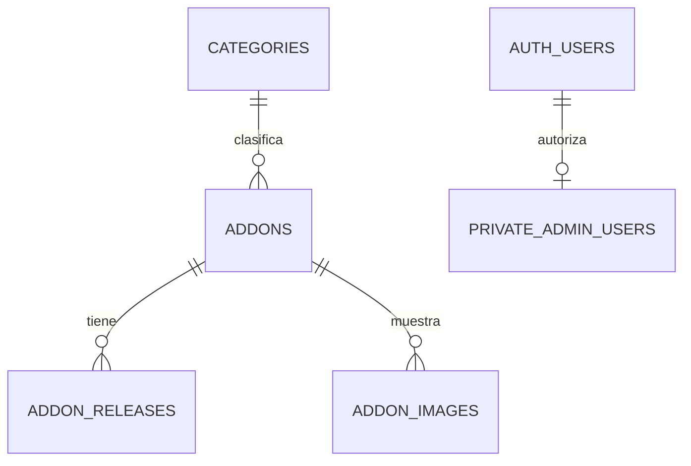

# Fase 4: esquema remoto y acceso administrativo

## Novena migración aplicada — estado vigente19/11

20261119144321_draft_asset_revision aplicada selectivamente, fichero renombrado al historial y tipos regenerados. Once archivos locales, nueve migraciones remotas; solo webhook/cuota Stripe siguen pendientes. No aplicar todo en lote. Tres políticas Storage restrictivas, RPC invoker y SQL transaccional revertido verificados, sin nuevos avisos de seguridad. Sin blobs ni cambios de Rumbo; nueva prueba HTTP con sesión del propietario pendiente. Este bloque prevalece sobre preparación local histórica inferior.

## Tercera migración local pendiente19/11

20261119142816_draft_asset_revision prepara reemplazo/eliminación de borradores, registro privado retirado y políticas Storage restrictivas, solo probada con PGlite. Once archivos locales/ocho migraciones remotas, tres pendientes. Esta migración no depende de las dos Stripe, revisar aplicación selectiva. No se ha aplicado ni regenerado tipos/asesores remotos. ARCHIVOS.md recoge prerequisitos y pruebas pendientes con sesión real.

## Segunda migración local pendiente19/11

20261119132832_support_checkout_budget prepara cuota privada RLS y RPC invoker solo backend, bloqueada transaccionalmente. Junto al webhook pendiente suma diez archivos locales y mantiene ocho migraciones remotas. Sin aplicar ni regenerar tipos remotos. Probada únicamente con PGlite; no confundir este estado con despliegue o validación PostgREST real.

## Esquema local pendiente de aplicar19/11

Remoto conserva ocho migraciones, incluida20261119112302_catalog_pagination. Nueva20261119130159_support_webhook_ledger SOLO local: sesiones/eventos test en private con RLS, RPC invoker solo service_role y sin acceso anon/authenticated. Probada con PostgreSQL PGlite persistente; sin aplicar, asesores remotos nuevos o tipos regenerados. Backend secret dedicado aún sin obtener/configurar. No confundir nueve archivos locales con nueve migraciones remotas. Ver APORTACIONES.md.

## Séptima migración — categorías19/11

20261119100814_category_management aplicada tras PGlite: categories.sort_order, auditoría de categorías en tabla existente, RPC invoker save_category. RLS sigue admin+aal2; eventos sin escritura de aplicación. Verificación remota con ROLLBACK y asesor sin nuevos avisos. Revisión HTTP real de UI pendiente. Menciones inferiores a seis migraciones son históricas.


## Estado más reciente — sexta migración editorial

20261119074101_editorial_workflow aplicada y tipos regenerados. Añade editorial_events con RLS SELECT solo admin+aal2, sin escritura para roles de aplicación; triggers privados registran cambios y RPC invoker administra transiciones atómicas con control de concurrencia. Pruebas locales SQL y prueba remota con ROLLBACK aprobadas. La prueba remota usa contexto SQL de claims, no tokens ni login real. Asesor sin avisos nuevos. QA visual/HTTP pendiente; no se publicó Rumbo. Menciones inferiores a cuatro/cinco migraciones son históricas.


## Estado real

Actualización 19/11: cinco migraciones. 20261118225704_addon_installation_instructions añade texto de instalación por addon con límite 30000; RLS heredada, sin grants nuevos. Tipos y DTO público actualizados. Editor autenticado de borradores usa listas de campos y control optimista updated_at/estado draft. Guardado HTTP real y conflicto comprobados con fixture eliminado; Rumbo no cambió. Ver ADMINISTRACION para alcance actual. Las menciones inferiores a cuatro migraciones son históricas.

Actualización: catálogo web y descarga conectados mediante /api/catalog y /api/download. Ambos consultan con publishable key y permisos anónimos, sin credenciales administrativas. API catálogo200 vacío porque Rumbo continúa en borrador; URL de ficha no expone metadatos locales. Diagnóstico real con fixture aprobó catálogo publicado, descarga idéntica por redirect firmado60s y404 tras retirada, con limpieza completa remota. Recuperación continúa fallando/aplazada; fase4 no cerrada. Las menciones inferiores de catálogo local son históricas.

Proyecto remoto `wow-forever-addons`, referencia `irhmsatozdhbvosgwqua`, región Irlanda (`eu-west-1`), PostgreSQL 17.12. Cuatro migraciones aplicadas mediante el conector Supabase, con historial remoto y nombres locales coincidentes. No reaplicarlas ni ejecutar resets. No se ha instalado Docker. Catálogo web aún local; Auth ya conectado.

Verificadas cinco tablas con RLS y dos buckets privados. `bootstrap_catalog.sql` creó Rumbo y su versión 0.3.0 en borrador con IDs generados, sin archivo ni aprobación de distribución. Asesores: última revisión avisa de protección de contraseñas filtradas desactivada (requiere Pro, no contratado); detalle en ADMINISTRACION.md. Rendimiento solo informa de índices sin uso en esta base nueva.

Auth: altas públicas y acceso anónimo de Auth desactivados, confirmación de correo activada. Un visitante sin sesión puede descargar publicaciones sin necesitar usuario Auth. URL y clave publishable en `.env` excluido de Git; no se ha obtenido clave secret/service_role. Tipos en `src/app/core/supabase/database.types.ts`.

`npm.cmd run verify:supabase`: comprobaciones HTTP reales de solo lectura con clave pública. Categorías accesibles, ningún borrador expuesto en la muestra, esquema privado no expuesto, altas desactivadas y RPC administrativo denegado a visitantes. Propietario creado y autorizado; confirmó acceso al área de gestión con MFA y se verificó un TOTP activo. Pendientes recuperación, reingreso/caducidad y operaciones HTTP de Storage.

Adaptador Auth real implementado. `public.admin_access()` solo consulta la identidad actual; `private.is_admin()` exige pertenencia y aal2 en todas las políticas de administración, incluidas las de Storage. Recuperación todavía desactivada. Véase ADMINISTRACION.md.

PGlite es una dependencia exclusiva de desarrollo para comprobar SQL, restricciones y RLS con un motor PostgreSQL. Los tests representan con tablas/funciones mínimas los esquemas de Supabase `auth` y `storage`; no prueban sus servicios HTTP, validación de JWT, correos, URLs firmadas ni límites reales de subida. La fase 4 sigue abierta hasta validar esa integración.

## Modelo para múltiples addons



- `categories`: categoría y visibilidad. Las categorías nuevas empiezan ocultas.
- `addons`: identidad, descripción, autor, licencia, créditos y estado. Empiezan como borradores. Publicar exige aprobación de distribución y fecha; la aprobación es una decisión editorial, no una autorización legal automática.
- `addon_releases`: versión, compatibilidad, changelog, ruta del ZIP, bytes y SHA-256. No se puede publicar sin esos metadatos. Debe comprobarse además que el archivo exista y corresponda al hash en el futuro flujo de publicación.
- `addon_images`: ruta, texto alternativo, orden y publicación independiente.
- `private.admin_users`: lista de administradores vinculada a Supabase Auth; sin acceso directo desde los roles del navegador. Ni siquiera un administrador de contenido puede otorgar otros administradores mediante la Data API.

La asignación de una categoría por addon simplifica la primera versión. No hay precios, compras ni licencias premium. Las aportaciones y sus datos privados se modelarán en su fase, sin mezclarlos con el catálogo.

## Matriz de acceso

| Operación | Visitante | Usuario autenticado normal | Administrador |
|---|---|---|---|
| Leer catálogo publicado | Sí | Sí | Sí |
| Leer borradores | No | No | Sí |
| Modificar catálogo | No | No | Sí |
| Descargar archivos publicados | Sí, sin cuenta | Sí | Sí |
| Leer/subir archivos en preparación | No | No | Sí, solo buckets del proyecto |
| Otorgar rol administrador | No | No | No desde el cliente |

La pertenencia se consulta en una función `security definer` con `search_path` vacío y permisos explícitos. No se confía en metadatos editables de usuario. La función reside en `private`, que NO debe añadirse a los esquemas expuestos por la Data API. El navegador no recibe claves que omitan RLS.

Al retirar la pertenencia, RLS deja de autorizar acceso privilegiado sin esperar caducidad de sesión. La migración admin_mfa ya exige aal2 en operaciones administrativas. El usuario completó la vinculación y acceso; queda validar cierre/reingreso y recuperación.

## Archivos gratuitos y borradores protegidos

Ambos buckets son privados para que una URL adivinada no permita descargar un borrador:

- `addon-files`: ZIP, bucket configurado en 100 MiB; dashboard FREE comprobado el 18/11 confirma global fijo 50 MB, que prevalece. No prometer subidas de 100 MiB.
- `addon-images`: PNG, JPEG o WebP, hasta 5 MiB. No se admite SVG subido por usuarios.

Las políticas permiten lectura anónima solo cuando el objeto coincide con los metadatos publicados, el addon está publicado y su categoría es visible. Los objetos huérfanos o pendientes no son públicos. Las escrituras se limitan a administradores y a estos dos buckets.

```text
addon-files/<addon-uuid>/<release-uuid>.zip
addon-images/<addon-uuid>/<image-uuid>.png|jpg|webp
```

En la fase de descargas, Storage entregará el objeto autorizado o una URL firmada breve usando permisos públicos sujetos a RLS. No se exigirá cuenta ni pago. No se implementa todavía la generación de enlaces ni se usa la clave secret/service_role para conceder acceso universal. Una URL ya firmada puede seguir siendo válida hasta que caduque; retirar la publicación no invalida retroactivamente enlaces emitidos.

El proceso de publicación futuro debe verificar ZIP, hash, tamaño, metadatos de compatibilidad, créditos y derechos; una restricción SQL no puede inspeccionar bytes en Storage. La eliminación de objetos se hará mediante Storage API, no borrando filas de `storage.objects` por SQL.

## Archivos y ejecución local

```text
supabase/migrations/20261118193901_catalog.sql
supabase/migrations/20261118193910_storage.sql
supabase/migrations/20261118194059_policy_consolidation.sql
supabase/migrations/20261118195617_admin_mfa.sql
supabase/bootstrap_catalog.sql
supabase/seed.sql
supabase/verify.sql
tests/database/catalog.test.mjs
```

```powershell
npm.cmd ci
npm.cmd run test:db
npm.cmd run check
```

Los tests crean una base efímera, aplican las migraciones reales y el seed dos veces, prueban permisos y la cierran. No conectan a ninguna red ni modifican bases existentes. El seed deja Rumbo y su versión en borrador, sin ZIP, administrador ni usuario ficticio. No ejecutar el bootstrap de los tests en Supabase: sus esquemas ya existen allí.

## Siguiente parte: usuario y servicios reales

Actualización: propietario ya ejecutó y aprobó Storage autenticado y publicación/retirada HTTP con fixtures temporales. Se comprobaron descarga anónima gratuita de publicación, borradores ocultos, escritura denegada al visitante, retirada, nuevas firmas bloqueadas, caducidad de URL previa y ocultación por padre/categoría. Consulta remota confirma cero fixtures/objetos y Rumbo intacto en borrador. Los pasos inferiores son históricos: no repetir alta de usuario ni bootstrap. Recuperación real, caducidad/renovación de sesión y usuario normal autenticado por HTTP siguen pendientes.

El proyecto ya existe y puede gestionarse desde el móvil sin estar conectado a la Wi-Fi del ordenador. La rama principal figura PRODUCTION en el dashboard, pero no hay web desplegada ni contenido publicado.

1. Propietario: Authentication → Users → Add user → Create new user. Introducir el correo acordado y una contraseña privada directamente en Supabase. Para su propia cuenta puede dejar Auto confirm user activado; este formulario no envía correo. No comunicar la contraseña a Codex.
2. Verificar la identidad del usuario antes de otorgar permisos. El acceso al dashboard no crea automáticamente un usuario Auth para la web.
3. Mantener `private` fuera de la Data API. Global FREE confirmado en dashboard: 50 MB; prevalece sobre bucket ZIP 100 MiB. Diagnóstico HTTP ejecutado por el propietario con sesión MFA: rechaza exceso de 50 MiB en ZIP y 5 MiB en imágenes, MIME incorrecto; subida/upsert/descarga, borrador oculto, firma/caducidad y limpieza correctos en ambos buckets. Consulta posterior confirma cero objetos _verification/.
4. Implementar adaptador Auth, URLs de redirección controladas y MFA. Validar recuperación y entrega de correo con un destino accesible.
5. Tras crear el usuario administrador, obtener su UUID en Auth y asignarlo desde SQL Editor con una sesión de propietario:

```sql
-- Sustituir el UUID por el usuario real previamente verificado.
insert into private.admin_users (user_id)
select id from auth.users
where id = '00000000-0000-0000-0000-000000000000'
on conflict (user_id) do nothing;
-- El UUID de ejemplo no concede permisos a nadie.
```

6. Ejecutar `supabase/verify.sql` y comprobar las operaciones con la API real: visitante, usuario normal y administrador. Verificar que la key pública no enumera borradores y que enlaces directos a buckets privados no eluden políticas.
7. Subir archivos de prueba mediante Storage API y comprobar MIME/tamaño, anonimato de descarga publicada, bloqueo de borradores, retirada y caducidad de enlaces.
8. Probar invitación, inicio/cierre de sesión, recuperación, MFA y denegación administrativa. Solo entonces cerrar fase 4 y conectar el catálogo en fase 5.

## Fuentes

- https://supabase.com/docs/guides/database/postgres/row-level-security
- https://supabase.com/docs/guides/storage/security/access-control
- https://supabase.com/docs/guides/storage/buckets/fundamentals
- https://supabase.com/docs/guides/local-development/database-migrations
- https://pglite.dev/docs/

20261119172251_support_receipt_status aplicada: decimotercera migración alineada, RPC invoker limitada a service_role, sin acceso anon/authenticated. Tipos remotos regenerados.
